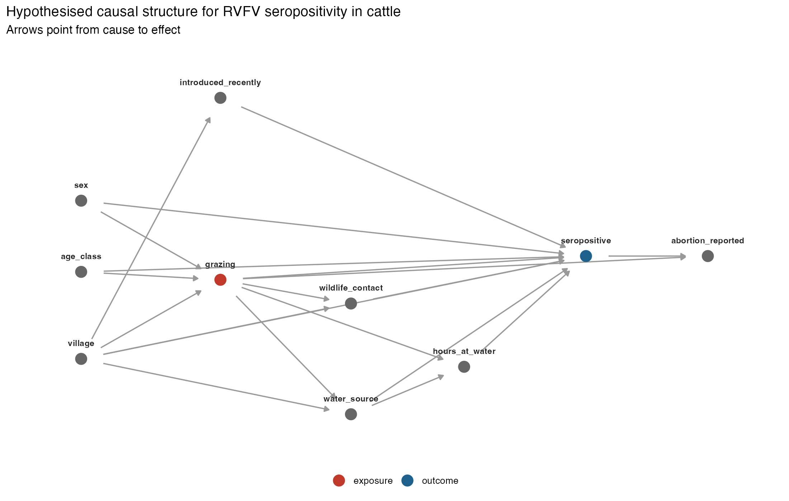
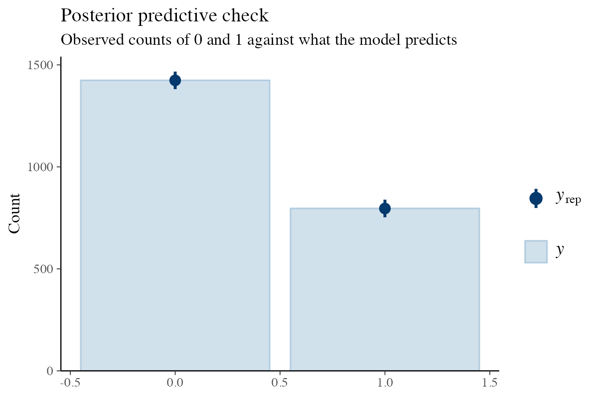
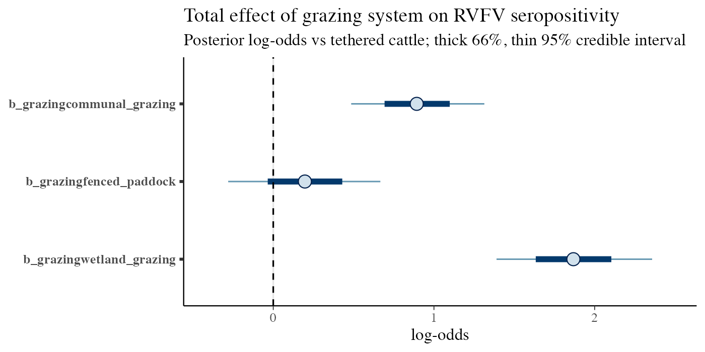
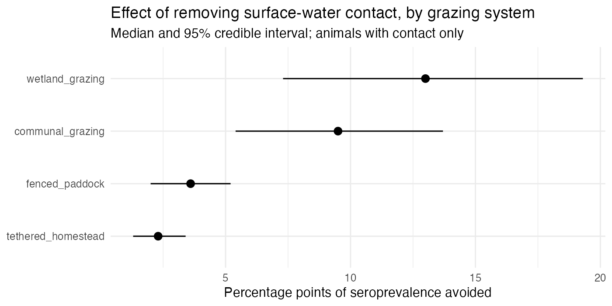

---
output:
  pdf_document: default
  html_document: default
---
Written by: Jessica Clark and Rivka Lim
---

# Causal analysis in R: the written tutorial

This file holds the explanation that goes with `02_causal_analysis_tutorial.R`.
The script holds the code and short operational comments. This file holds the
reasoning, the function-by-function reference and how to read each output.
Read a section here, then run the matching section of the script.

`README.md` is the repository overview and the file list. This is the teaching
text.

## Contents

- [What this tutorial is for](#what-this-tutorial-is-for)
- [Why standard regression is not sufficient](#why-standard-regression-is-not-sufficient-a-worked-example)
- [The research question](#the-research-question)
- [How to use the files](#how-to-use-the-files)
- [0. Setup](#0-setup)
- [1. Read the data and set reference levels](#1-read-the-data-and-set-reference-levels)
- [2. How every model in this tutorial is fitted](#2-how-every-model-in-this-tutorial-is-fitted)
- [3. The crude model](#3-the-crude-model-a-grazing-only-regression)
- [4. Draw the DAG](#4-draw-the-dag)
- [5. Test the DAG against the data](#5-test-the-dag-against-the-data)
- [6. Paths](#6-paths)
- [7. Let the DAG choose your covariates](#7-let-the-dag-choose-your-covariates)
- [8. Estimate the total effect](#8-estimate-the-total-effect)
- [9. Estimate the direct effect, and read the mediation](#9-estimate-the-direct-effect-and-read-the-mediation)
- [10. Alternative model specifications](#10-alternative-model-specifications)
- [11. A continuous exposure](#11-a-continuous-exposure-hours-at-surface-water)
- [12. Counterfactual interventions](#12-counterfactual-interventions)
- [13. Sensitivity analysis](#13-sensitivity-analysis-how-wrong-could-this-be)
- [14. How to write this up](#14-how-to-write-this-up)
- [Function reference](#function-reference)
- [Further reading](#further-reading)

---

## What this tutorial is for

This tutorial will guide you through how to conduct a causal analysis: 
the first step is to draw a diagram called a DAG, of what variables you believe 
causes the outcome, then you use it to choose the covariates for each
model to estimate total and direct effects. Models are fit with the `brms` package, 
using the outputs you can simulate what would happen if a practice changed, 
and test how far the assumptions could be wrong before the "causal" conclusion breaks.

The worked example provided here is a simulated RVFV serosurvey in cattle. The data 
structure is based on the real study but the premise, variables and serodata are fake. 
The analysis follows the analysis structure of Lim et al. (2026), 
*Local habitual movement as a mechanism for* Schistosoma mansoni *transmission resurgence: a causal analysis of
cross-sectional survey data*, BMJ Public Health 4:e004500,
[doi:10.1136/bmjph-2025-004500](https://doi.org/10.1136/bmjph-2025-004500).

## Why standard regression is not sufficient: a worked example

But why use a causal analysis and not just standard regression?

Say you want to know whether grazing style has an impact on sero-status. Your
most basic model would be `sero-status ~ grazing`, which estimates how much
serostatus differs between grazing systems and how far that difference would
move in another sample from the same population. What it does not say is whether
grazing causes the difference or is correlated with something else that does.

Whilst wetland-grazed cattle in this simulated survey are more often
seropositive than tethered cattle, these two groups differ in more than how they
are grazed. They differ in where they live, because whether an animal is
wetland-grazed is decided by whether its village has wetland, and that is also
where the vectors breed. They also differ in age, because farmers tether the
youngest animals near the homestead, so the tethered group holds a far larger
share of calves, and a calf has had fewer years in which to be infected than an
adult whatever its management. In this simple model the regression coefficient
`grazing` adds these differences together and reports the sum as one number.
More data does not fix this, because a larger sample narrows the interval around
the same wrong number.

The obvious response is to put the other variables into the model, which works
for some of them but does not really get to your question with other variabels.

For example;

- `village` and `age_class` are reasons the two groups of animals differ before
  any grazing happens (as in you live in a wetland village and so you choose
  wetland grazing), so including them in a regression model removes a difference
  that was never caused by grazing. They belong in the model and are called
  confounders.

- `hours_at_water` is a mediator. When a style of grazing is chosen, this
  inherently changes the amount of time an animal will spend drinking at a
  waters edge, so a wetland-grazed animal will spend longer there whilst a
  tethered animal is more likely to have water brought to it. Including it takes
  out part of the effect of grazing you are trying to measure.

The two variables need opposite treatment but look identical to the model, because each
enters as a column of numbers and each moves the coefficient. They also look
identical in the data, since both are correlated with grazing and with
seropositivity, so no correlation matrix distinguishes them. Correlation carries
no direction either. Grazing and seropositivity are correlated by the same
amount whether wetland grazing causes infection or farmers move sickened animals
off the wetland, so the number cannot tell you which of the two is happening.
This is where casual modelling comes in.

What separates them is knowledge of the biology, and a DAG is how that knowledge
gets written down in a form an algorithm can read. None of this proves the
structure, because the arrow direction (described below) leaves no trace in an
association, so the diagram is an assumption you supply from biology and the
literature. Putting it on the page is what lets a reader reject one arrow and
work out what it changes.

This will hopefully make a bit more sense as you start making your DAG and going 
the analysis. 

## The research question

Does the way cattle are grazed and watered cause RVFV seropositivity, and by how
much would seroprevalence fall if those practices changed?

## How to use the files

Run `02_causal_analysis_tutorial.R` top to bottom, one block at a time, with
the matching section of this file open beside it. Every model is fitted in
`brms` so the first run compiles around a dozen Stan programs
and takes 10 to 20 minutes. After that the fits are cached in `models/` and
re-runs are instant. Delete `models/` if you change the data or a model
formula.

`brms` needs a working C++ toolchain, which is a program outside R rather than
an R package. On macOS install the Xcode command line tools with
`xcode-select --install`, or get Xcode from the App Store. 

---

## 0. Setup

Six packages are installed and four are loaded. These will load when you run your scipt. 

| Package | What it is for |
|---|---|
| `dagitty` | Build the DAG, find adjustment sets, test the DAG against the data |
| `ggdag` | Draw the DAG as a `ggplot2` figure |
| `tidyverse` | `ggplot2` for every figure, `dplyr` for `mutate()` and `bind_rows()` |
| `brms` | Fit every model |
| `fastDummies` | Used inside `dagitty`, never called by you |
| `CCP` | Used inside `dagitty`, never called by you |

`tidyverse` prints a list of name conflicts when it loads, which is expected
and can be ignored. The two relevant here are `dplyr::filter` and
`dplyr::lag`, which mask the base versions.

`fastDummies` and `CCP` get installed but never loaded, because
`localTests(type = "cis.pillai")` calls them internally in section 5 and stops
with an error if they are missing. Installing a package puts it on your
computer; loading it with `library()` puts its functions on your search path.
A package another package calls internally needs only the first.

`dir.create("figures")` and `dir.create("models")` make the two output folders.
`showWarnings = FALSE` stops R complaining when the folder is already there.
`set.seed(1)` fixes the random number stream so the same run gives the same
numbers twice.

## 1. Read the data and set reference levels

The dataset is a simulated single cross-sectional survey: 2220 cattle from 200 herds in
38 villages, with one blood sample per animal and the management of each animal
recorded from its owner's questionnaire.

| Column | What it is |
|---|---|
| `seropositive` | 1 if antibodies to natural RVFV infection detected |
| `grazing` | How the animal is grazed |
| `water_source` | Where its drinking water comes from |
| `hours_at_water` | Hours per day in or at the edge of surface water |
| `wildlife_contact` | Shares grazing or watering points with wildlife |
| `introduced_recently` | Bought into the herd in the last 12 months |
| `village`, `age_class`, `sex`, `herd_size`, `herd_id` | Design and demography |

Every management variable varies within a herd, because an owner tethers the
youngest animals at the homestead while the rest of the herd goes out, and 197
of the 200 herds hold two or more grazing systems as a result. The effect of
grazing can therefore be estimated separately from differences between herds.

Because this is a single visit with one blood sample per animal, the outcome is
**seroprevalence**, the proportion carrying antibodies from any past infection,
not seroconversion. Antibodies to RVFV persist for years, so an animal's
serostatus accumulates exposure over its whole life. That is why `age_class`
has to be in the model: an adult has had more years in which to be infected
than a calf, whatever its management.

**Reference levels.** R orders factor levels alphabetically, so the reference
category in every model would be whichever level happens to come first in the
alphabet. In this instance, I have decided we are testing all grazing methods 
against tethering at the homestead, and so the factors need to be relevled. You 
can set the reference to the lowest-risk or baseline level yourself with
`relevel()`, otherwise every coefficient is a contrast against something
arbitrary (i.e. just the factor which comes first in the alphabet).
`age_class` is set with `factor(levels = c(...))` instead, which
fixes the whole ordering rather than only the first level.

**Describe the data before modelling it.** Before you do any modelling you want 
to have a look at the data and check it looks as it should. All your serostatus 
values are 0/1 for example, that none of your village have N = 0 etc. 
This script prints overall seroprevalence, the spread between villages, 
seroprevalence by grazing system, seroprevalence by age class, and a 
cross-tabulation of grazing against water source.

**How to read it.** Seroprevalence is about 36% overall, with a village median
of 26% and a range from 2% to 79%, so village is a large source of variation
and will have to be dealt with. Seroprevalence rises from about 14% in tethered
cattle to about 69% in wetland grazers, and from 20% in calves to 42% in
adults, which is expected for a cumulative marker of past exposure. Nearly three
quarters of wetland grazers drink from a river or a dam, whilst over half of
tethered cattle have water carried to them. Exposures that are strongly
correlated like this cannot be separated by the data alone, which is the first
reason you need a causal diagram rather than a regression.

## 2. How every model in this tutorial is fitted

The models are fitted in a Bayesian framework using `brms`. 
A Bayesian fit returns a full posterior distribution for each effect/ coefficient 
rather than a point estimate and an interval. This means you can say how probable 
an effect of a given size is. because the proprtion of values that are >0 is the probability
that the value will always be that effect. The posterior draws are also then used 
in the counterfactual simulations in section 12.

### Priors

A prior says what effect sizes are plausible before seeing the
data. `normal(0, 1.5)` on the log-odds scale is centred on no effect and treats
odds ratios beyond about 1/20 to 20 as unlikely. That is weakly informative: it
rules out absurd values and leaves the data to decide everything else. Refit
under a couple of other priors and report that the conclusions did not change. 
Priors do feel a bit hand-wavey if you have never used them before, but they also 
do make use of your knowledge. We can work on these together more if you are unsure. 

```r
# Lets set some binary priors for use in all our models in this tutorial

pr_bin <- c(prior(normal(0, 1.5), class = "b"),
            prior(normal(0, 2),   class = "Intercept"))
```

`class = "b"` applies the prior to every regression coefficient (beta) at once and
`class = "Intercept"` to the intercept, which needs a wider prior because it
carries the population-level average seroprevalence rather than a contrast. `prior()` comes
from `brms`, so `library(brms)` has to have run before this line or R reports
`could not find function "prior"`.

**The three helper functions** are described in the
[function reference](#function-reference): `fit_bin()` wraps the sampler
settings, `or_table()` turns log-odds into odds ratios, and `p_positive()`
gives the posterior probability that an effect is positive.

On that last one, the proportion of the posterior above 0 is the probability
that the effect is above 0, which is a statement no frequentist model can make,
because a p-value is the probability of the observed data under the null
hypothesis rather than the probability of a hypothesis. The posterior
probability is a property of the Bayesian framework, not of the causal
analysis. The causal part is which variables went into the model.

## 3. The crude model: a grazing-only regression

The first model includes grazing as an explanatory variable and nothing else,
so that every later model can be read as a change from this starting point.

**How to read it.** Wetland grazing comes out at 13.6 times the odds of
seropositivity compared with tethered cattle, with a credible interval of 10.1
to 18.3, well clear of 1. The interval rules out chance as an explanation. It does not
establish that grazing is the explanation, because the model contains no way to
distinguish the effect of grazing from the effect of anything correlated with
it.

The estimate is therefore not wrong as a description of these cattle. It is
insufficient as an estimate of what grazing does, which is the quantity the
research question asks for.

Sections 4 to 7 work out which variables have to enter the model to recover the
effect of grazing.

## 4. Draw the DAG

A DAG (directed acyclic graph) is a drawing of what you believe causes what.
Four rules:

1. One node per variable.
2. One arrow per direct cause, pointing from cause to effect.
3. No loops. If A causes B, nothing downstream of B can cause A.
4. The arrows come from subject knowledge, published studies and expert
   opinion, never from the data.

Missing an arrow that really exists is an assumption that can bias your
estimate, so it is safer to include a plausible arrow than to leave it out.

The arrows in this DAG are drawn from the RVF literature: wetland and riverine
grazing and shared watering points raise exposure to *Aedes* and *Culex*
vectors; animals bought in to replenish a herd can import infection; shared
grazing with wildlife raises vector contact.

The data in this tutorial are simulated, so the DAG matches the rules that
generated them, and some of those rules are simpler than a real herd. In the
simulation the chance that an animal was bought in depends on its village and
its herd and on nothing about the animal, so `introduced_recently` has an arrow
from `village` and none from `age_class` or `sex`. A DAG for a real dataset
would be expected to have both of those arrows, because bought-in animals are
mostly adults rather than calves born in the herd, and because owners buy
females and males for different purposes.

### Start large, then trim

The first version of a DAG can be large. Draw every variable you can think of
that might lie on the causal path or influence the relationship, whether or not
it was measured. A variable you did not measure belongs in this first version
for three reasons and is marked `[latent]` (see the table below).

1. It states the assumption. A DAG without the variable claims it does not
   exist, so every adjustment set is correct only under that claim. With the
   variable drawn, `adjustmentSets()` returns only sets that block every
   backdoor path without using it, and returns none if no such set exists, which
   means the effect cannot be identified from your data.
2. It shows what can substitute for it. A measured variable on the same path,
   such as a proxy for the unmeasured one, may block the path, and the DAG shows
   which measured variable can do this.
3. It decides what to do when nothing can substitute for it. The options are a
   sensitivity analysis such as the E-value in section 13, or collecting the
   variable in the next study.

The DAG is then trimmed to what the question needs, in two cases:

1. A variable with an arrow into the outcome and no connection to the exposure
   can be removed, because the DAG describes the causal relationship you are
   estimating and nothing else. Leaving it in the model can make the estimate
   more precise, but removing it does not bias the estimate.
2. In a chain, an outer node that points only into the middle node and nowhere
   else can be removed if you are not interested in it, because all the
   variation it adds to the outcome passes through the middle node.

### The syntax

```r
rvf_dag <- dagitty('dag {
  village                [pos="0.0,1.0"]
  grazing                [exposure, pos="1.6,2.0"]
  seropositive           [outcome, pos="5.8,2.3"]

  village -> grazing
  village -> seropositive
  grazing -> seropositive
}')
```

The whole DAG is one character string, wrapped in `dag { ... }` and passed to
`dagitty()`. Three kinds of line go inside it.

- `A -> B` means A causes B. 
- `A [attribute]` sets an attribute of node A. Several attributes are separated
  by commas inside one pair of brackets.
- A node name on its own introduces a variable with no attributes, which is
  rarely needed because any name used in an arrow is created automatically.

Names must match the column names in your data exactly, otherwise the DAG
cannot be tested against the data later.

The online version of dagitty at <https://www.dagitty.net> lets you move nodes
and add or change arrows with the mouse, so you can see the structure as you
build it. The code it produces can be copied and pasted into `dagitty('...')`
in R. This is a great place to start! 

### Deciding the role of a node

The brackets hold two different things: a **role**, which changes the analysis,
and a **position**, which changes only the figure.

| Attribute | What it does |
|---|---|
| `[exposure]` | Marks the variable whose causal effect you want to estimate |
| `[outcome]` | Marks the variable you are explaining |
| `[latent]` | Marks a variable you believe exists but did not measure |
| `[adjusted]` | Marks a variable you have already conditioned on |
| no attribute | An ordinary measured variable |

Only one role decision is a judgement call about the science, which is which
variable is the exposure. It is the variable in your research question, so for
"does grazing cause infection" the exposure is `grazing` and the outcome is
`seropositive`. One DAG answers one such question at a time. To ask what water
source does instead, pass `exposure = "water_source"` to `adjustmentSets()`
rather than editing the DAG, which is what section 7 does for each of the six
exposures in turn.

**Confounder, mediator and collider are not attributes you set.** They are
roles the arrows give a node relative to the exposure and outcome you picked,
and `dagitty` works them out from the structure.

Every connection between exposure and outcome runs along a path. Some paths
carry the causal effect you want. Others carry bias. The job is to block the
bias paths and leave the causal paths alone. A node's role is the shape of the
path it sits on, and there are three shapes.

**Chain.** `grazing -> hours_at_water -> seropositive`. The middle variable is
a **mediator**, because it sits on an arrow chain from `grazing` to
`seropositive`. Conditioning on it removes part of the effect you are trying to
measure, so leave it out when you want the total effect.

**Fork.** `grazing <- village -> seropositive`. The middle variable is a
**confounder**, because it has an arrow into both `grazing` and `seropositive`.
It creates association without causation, so conditioning on it is required.

**Collider.** `grazing -> water_source <- village`. Arrows from `grazing` and
from `village` both point into `water_source`, which makes it a **collider** on
this path. The two parents are not linked through a collider until you
condition on it, and conditioning on a collider *opens* the path between its
parents, which can create a false association. `water_source` is a mediator on
one path and a collider on another, because it sits on the chain
`grazing -> water_source -> seropositive` and is also where the arrows from
`grazing` and `village` meet. This happens in real data, so a variable's role
has to be read path by path. The direct-effect model conditions on
`water_source` to remove the mediated route, which also opens
`grazing -> water_source <- village`. That is harmless here because `village`
is in the model and blocks the opened path. It would not be harmless if the
other parent were unmeasured, which is the situation section 13 draws with a
hidden variable.

The same variable can change role when you change the exposure: `water_source`
is a mediator of the grazing effect and a confounder of the `hours_at_water`
effect. Section 6 lists the paths in this DAG and section 7 reads the
adjustment sets off them.

`[latent]` is the one role that changes what `dagitty` will allow itself to
use. A latent node can be drawn and reasoned about, yet it is excluded from
every adjustment set, because you cannot condition on a column you do not have.
Section 13 uses this to show that once distance to water is added as a latent
confounder, `adjustmentSets()` returns nothing at all.

### Deciding the position of a node

`pos="0.0,1.0"` gives the node's x and y coordinates in the drawing. The two
numbers are in arbitrary units, so only their relative values affect the drawing, and
`pos="0,1"` and `pos="0,100"` differ only in the scale of the whole figure.
The first number is the horizontal position and the second is the vertical
position, so a larger first number moves the node to the right and a larger
second number moves it up.

**Position changes nothing about the analysis.** The implied conditional
independencies, the paths, the adjustment sets and every estimate are
identical whether you set positions or leave them out. They exist so that the
figure is readable, and a readable figure is what a reviewer uses to check your
arrows.

Leave `pos` out and `tidy_dagitty()` picks a layout for you with its
`layout = "nicely"` default, which gives a different arrangement each time
unless you set a seed. For a DAG you are publishing, set the positions by hand.

The layout used here puts causal order on the horizontal axis and keeps
variables of the same kind in a vertical column.

| x | What sits there |
|---|---|
| 0.0 | `village`, `age_class`, `sex`: the confounders, upstream of everything |
| 1.6 | `grazing`, the exposure, and `introduced_recently` |
| 3.1 | `water_source` and `wildlife_contact` |
| 4.4 | `hours_at_water`, downstream of both grazing and water source |
| 5.8 | `seropositive`, the outcome |

Reading left to right therefore follows the causal order, and the y values
spread the nodes within a column so their labels do not overlap. One practical
rule for choosing them: give any node whose arrow would otherwise cross several
others a y value that moves it clear of them.

### Drawing it

`tidy_dagitty()` turns the DAG into a data frame of nodes and edges, which is
what `ggplot2` needs. `node_status()` adds a column flagging which node is the
exposure and which is the outcome, so the plot can colour them. The `mutate()`
line turns the `NA` status of every other node into the string `"other"`,
because `scale_colour_manual()` needs a value to match. Labels go beside the
points with `nudge_y` rather than inside them, because variable names are too
long to fit in a circle.



*Figure 1. The DAG, written to `figures/01_dag.png`. Arrows point from cause to
effect.*

**How to read it.** Read the drawing and check each arrow against what you know
about the system. Three features of this DAG decide everything that follows.

- `village`, `age_class` and `sex` sit upstream of both `grazing` and
  `seropositive`, which makes them confounders of the grazing effect.
- `water_source`, `hours_at_water` and `wildlife_contact` sit between `grazing`
  and `seropositive`, which makes them mediators. They are
  part of how grazing causes infection, not a nuisance to be removed.
  `water_source` and `wildlife_contact` are also colliders on other paths,
  because arrows from both `grazing` and `village` point into each of them.
- `hours_at_water` has no arrow into `grazing`, because the amount of time an
  animal spends at water is a consequence of how it is grazed and watered.

### What the arrow directions assume

The direction of every arrow is an assumption about temporal order. 
Two DAGs that differ only in the direction of one arrow
can imply exactly the same independencies, so section 5 will accept both. The
assumption has to be defended from the design and the biology: management
practice is recorded for a period that precedes the blood sample, antibodies
persist for years so they cannot have caused a grazing decision taken earlier.
Where reverse causation is
plausible, say so. Farmers moving sickened animals off the wetland would
produce the same association as wetland grazing causing infection, and this
analysis cannot tell the two apart.

## 5. Test the DAG against the data

A DAG makes checkable claims. Every pair of variables with no arrow between
them should be independent once you condition on the right other variables.
These claims are the implied conditional independencies, and
`impliedConditionalIndependencies()` lists them. The printed form
`A _||_ B | C` reads "A is independent of B given C".

`localTests()` checks each claim in the data. `type = "cis.pillai"` is the
version that copes with a mix of categorical and continuous variables. The
`dag_vars` line keeps only the DAG variables that are columns in the data,
because `localTests()` stops if a name is missing.

**How to read it.** `estimate` is the leftover association after conditioning,
on a scale where 0 means the claim holds. None of the 22 tests reaches
p < 0.05, where 1 or 2 would be expected from chance at the 5% level, and no
estimate is above 0.15, so the DAG is compatible with the data.

The estimate comes out larger by chance alone when one of the variables has
many categories, as `village` does with 38. For any test involving `village`,
judge the claim by its p-value and not by the size of its estimate.

A violation that is both large and significant means an arrow you left out
probably belongs in. Add it, re-test, and say in your methods that you did.

What this test cannot do is confirm the DAG, because several different DAGs
imply exactly the same independencies. It only rules out DAGs that the data
clearly contradict. Arrow direction is the main thing it cannot see, as set out
at the end of section 4.

## 6. Paths

`paths()` lists every path between the exposure and the outcome. The three path
shapes, and what to do with each, are set out in section 4 under "Deciding the
role of a node".

Confounders are found by looking for open backdoor paths, which are paths that
leave the exposure through an arrow pointing *into* it. The
`grepl("^grazing <-", ...)` line picks those out of the full path list by
matching the arrow direction in the printed path.

**How to read it.** 23 paths connect grazing to seropositivity and 7 of them
are backdoor paths. Every one of those 7 starts at `village`, `age_class` or
`sex`, because those are the only three variables with an arrow into `grazing`.
All 7 are open, and all 7 have to be blocked. You do not have to work out how
by hand, because the next section does it for you. The principle is that paths
leaving grazing through a backward arrow carry bias, and paths leaving through
a forward arrow carry the effect.

## 7. Let the DAG choose your covariates

This is the step that makes the analysis causal, because `adjustmentSets()`
reads the DAG and returns the covariates that block every bias path while
leaving the causal paths intact. You no longer choose covariates by p-value or 
stepwise selection; all of which can introduce bias of their own.

`effect = "total"` asks for everything the exposure does to the outcome by any
route. `effect = "direct"` asks what is left when the mediators are held fixed.
The function can return more than one valid set, in which case any of them
identifies the effect and you pick on grounds of measurement quality and
sample size.

**How to read it.** The total effect of grazing needs
`{village, age_class, sex}` and nothing else. The direct effect needs those
three plus all three mediators. Each of the other exposures gets its own set,
and they are not the same as each other: hours at water needs
`{grazing, water_source}`, wildlife contact needs `{grazing, village}`, and
recent introductions need `{village}` alone. One model containing every variable at once would answer
none of these questions correctly, because the mediators belong in some sets
and not others. In causal analysis you fit one model per exposure, not one
model per analysis.

A DAG is built for the relationships it will be used to estimate. If you want
the effect of more than one exposure, the DAG must contain every variable
related to each of those relationships. A common mistake is to build and test a
DAG for one relationship and then use it for others, which is only valid if the
DAG was also drawn with those relationships in mind. The DAG in section 4 gives
an adjustment set for each of the four exposures because it was drawn with all
four in mind.

Record these sets in your methods. They are the formal statement of what your
estimates mean.

### From the DAG to a structural equation

The DAG says which variables cause which but not how. A structural equation
gives the how for one node. It writes the node as a function of its parents,
which are the variables with an arrow into it, plus random noise that stands for
every other influence on it. The DAG in section 4 gives `seropositive` eight
parents, so its equation is

```
seropositive = f(village, age_class, sex, grazing, water_source,
                 hours_at_water, wildlife_contact, introduced_recently) + noise
```

Writing the equation means choosing the form of `f` and the distribution of the
noise. For a 0/1 outcome the usual choice is a logit link with Bernoulli noise,
which is the family used in every model in this tutorial. That choice is the
`brm()` call itself, because the right-hand side of the formula is `f` and the
`family` argument is the noise.

```r
brm(seropositive ~ grazing + village + age_class + sex + ...,   # f
    family = bernoulli(link = "logit"))                         # the noise
```

Every other node has its own equation in terms of its own parents. For example
`wildlife_contact` is a function of `village` and `grazing` plus noise, and
`hours_at_water` is a function of `grazing` and `water_source` plus noise. The
simulation in `01_simulate_data.R` writes these equations out with known
coefficients, and the models in this tutorial estimate them from the data.

Not every model in sections 8 and 9 is a full equation. The direct-effect model
is the equation for `seropositive` without `introduced_recently`, which is left
out because it is not needed to estimate the grazing effect. The total-effect
model also leaves out the three mediators, so its grazing coefficient already
contains the effect of grazing on each mediator.

The noise terms are assumed to be independent between nodes. This is the same
claim the DAG makes, because correlated noise in two nodes would mean something
not drawn in is a common cause of both. Once each equation has a distribution
for its noise, it defines a probability model for its node given its parents,
`P(node | parents)`. The DAG is then a Bayesian network, and the joint
probability of all the nodes is the product of those probability models:

```
P(all nodes) = P(village) * P(age_class) * P(sex)
             * P(grazing | village, age_class, sex) * ...
             * P(seropositive | its eight parents)
```

Parameterising the DAG means fitting each structural equation to the data. The
fitted equations are then used to calculate each node from its parents in turn,
starting with the nodes that have no parents at the top of the DAG and ending
with `seropositive`.

A Bayesian fit gives a posterior for the parameters of every equation, which
states how uncertain each equation is. The equations are joined by the arrows,
so simulating through them in section 12 carries that uncertainty from one node
to the next and into the final estimate. Other methods can do this, for example
a bootstrap, but the posterior draws are already produced by the fit.

## 8. Estimating the total effect

The outcome is binary, so the model is Bernoulli with a logit link. It contains
the exposure plus the adjustment set from section 7, and nothing more.

**Check convergence before reading any result.** `Rhat` compares variation
between chains with variation within them, and values above 1.01 mean the
chains have not settled on the same answer and the numbers cannot be trusted.
`Bulk_ESS` and `Tail_ESS` are effective sample sizes, and anything above a few
hundred is fine.

The posterior predictive check simulates new datasets from the fitted model and
compares them with the data you actually have. The outcome is 0/1, so
`type = "bars"` is the right display: the pale bars are the observed counts of 0
and 1, and the dark points with intervals are what the model predicts. The
default density overlay is designed for continuous outcomes and is unreadable
here.



*Figure 2. The posterior predictive check for the total-effect model, written to
`figures/02_ppcheck.png`.*

**How to read it.** `Rhat` is 1.00 and the smallest effective sample size is
about 1700, well above the few hundred you need, so the chains converged. The
village coefficients fill most of the printout and have the lowest effective
sample sizes among the slopes, because the smallest village contributes 36
animals; scroll past them to the grazing rows. In the predictive check the observed counts sit
inside the predicted range, so the model reproduces the observed
seroprevalence.



*Figure 3. The total effect of each grazing system against tethered cattle, on
the log-odds scale, written to `figures/03_posterior_grazing.png`. The thick bar
is the 66% credible interval, the thin bar the 95% interval, and the dashed
line at 0 is no effect.*

Read each odds ratio as: the odds of being seropositive for an animal under
this grazing system, divided by the odds for a tethered animal of the same age
and sex in the same village. Wetland grazing comes out at OR 7.5 with a
credible interval of 5.4 to 10.6, well clear of 1, so wetland grazing causes a
large increase in infection risk under this DAG. Communal grazing is OR 3.2.
Fenced paddock is OR 1.9 with an interval of 1.4 to 2.7, a smaller effect whose
interval is also above 1.

The posterior probabilities say the same thing more directly. All three
grazing systems increase risk relative to tethering with probability 1.00,
because no posterior draw for any of the three coefficients is below zero.

Compare with the crude OR of 13.6 in section 3. Close to half of the crude
association was village and age confounding.

## 9. Estimating the direct effect and reading the mediation

The direct-effect model adds the three mediators to the same adjustment set.
`merge()` puts the two sets of odds ratios side by side on the `term` column,
with `suffixes` naming which is which.

**How to read it.** The wetland grazing OR falls from 7.5 (total) to 3.3
(direct), and its interval drops from 5.4–10.6 to 2.3–4.9. That drop
is the answer to a scientific question rather than a problem with the model. It
says most of what wetland grazing does to infection risk runs through the
mediators: through drinking from rivers and dams, through hours spent at the
water's edge, and through wildlife contact. This is
partial mediation. 

Note what this means for control. If you could keep cattle in wetland areas but
change their watering and their contact with wildlife, you would remove most of
the risk. The wetland location itself is doing comparatively little.

When you report the two, call the total effect "the effect of grazing". Report
the direct effect next to it, named as the direct effect and with the mediators
it excludes listed. For example:

> Wetland grazing increased the odds of seropositivity relative to tethering,
> with a total effect of OR 7.5 (95% CrI 5.4–10.6). The direct effect, which is
> the effect not operating through water source, hours at water or wildlife
> contact, was OR 3.3 (2.3–4.9).

## 10. Alternative model specifications

This section fits the same outcome four times, changing only which other
variables go in the model alongside grazing, and compares the wetland odds
ratio from each. The first three models were fitted in sections 3, 8 and 9.

| Model contains | Wetland OR | What the number is |
|---|---|---|
| grazing alone | 13.6 | Too high. Village and age differences are counted as grazing. |
| grazing + village, age, sex | 7.5 | The total effect of grazing. This answers "what does grazing do to infection risk". |
| the above + water source, hours at water, wildlife contact | 3.3 | The direct effect, which is the part of the grazing effect that does not go through those three. |
| every variable in the dataset | 3.4 | The direct effect again. The only variable added to the previous model is `introduced_recently`, which has no arrow from `grazing`, so it leaves the estimate unchanged. |

The first model leaves confounding in, and the second and third answer two
different questions about the same exposure. The fourth repeats the third
because a covariate with no arrow from the exposure does not change what is
being estimated.

`simulation_truth.csv` holds the coefficients that generated the data, so the
direct effect can be checked. The true simulated direct effect is OR 2.59. The DAG direct estimate is 3.3
with an interval of 2.3 to 4.9, so the interval contains the truth and the
estimate sits above it. That is the direction in which the unmeasured
confounder described in section 13 pushes it.

## 11. A continuous exposure: hours at surface water

The adjustment set for `hours_at_water` from section 7 is
`{grazing, water_source}`, which differs from the grazing set because the
backdoor paths are different.

A per-hour OR is hard to interpret, so convert it to the contrasts people care
about. An odds ratio for a continuous predictor is multiplicative per unit, so
the effect of *k* units is `exp(beta * k)` rather than `k` times the OR.

**How to read it.** Each extra hour per day at surface water multiplies the
odds of seropositivity by 1.25, with a credible interval of 1.13 to 1.38. A
small per-unit effect accumulates: four hours a day, which nearly a quarter of
the wetland-grazed cattle exceed, carries about 2.4 times the odds of an animal
with no surface-water contact. Report the cumulative
contrast as well as the coefficient.

This estimate assumes the effect is linear on the log-odds scale. Check that
before trusting it, for instance by refitting with `s()` splines or with hours
cut into bands, and say what you found.

## 12. Counterfactual interventions

A coefficient answers "how much more likely is infection in wetland-grazed
cattle". A counterfactual answers "what would seroprevalence be if those cattle
were grazed differently". The second is the question a control programme
actually asks.

An intervention sets a node to a value you choose and ignores the arrow into
it, because the value no longer depends on that node's parents. Everything
downstream of it is then recalculated from its parents using the fitted
equations, which shows what changes. This is written `do(node = value)`, as in
the heading of scenario B.

The recipe:

1. Copy the observed data.
2. Edit the exposure column to the intervened value, plus any variable
   downstream of it that must change as a consequence.
3. Predict from the model that was fitted to the **original** data.
4. Compare predictions on the original and edited data, draw by draw.

Step 3 is important because refitting the model to the edited data would answer a
different question. The fitted model is the causal mechanism and the edited data
is the new input.

Step 4 is important because the difference has to be computed inside each posterior
draw and then summarised. Subtracting two summary means gives a number with no
interval attached, whereas differencing draw by draw gives a posterior for the
reduction itself.

### Scenario A: move all wetland grazers to tethered grazing

**How to read it.** Seroprevalence in the whole population falls from 36% to
29%, a drop of about 7 percentage points. Among the wetland-grazed animals
themselves it falls from 69% to 30%, a drop of about 39 points. That gap shows that an
intervention can work well for the individuals it reaches and still move the
population number only a little, because those individuals are a minority of
the herd. Report both numbers. The subgroup figure is what a farmer experiences
and the population figure is what a control programme achieves.

Taking the difference draw by draw gives an interval on the reduction itself.
Here it runs from 5.9 to 8.1 points and stays clear of zero, so the reduction
is supported.

### Scenario B: remove surface-water contact, do(hours_at_water = 0)

The same recipe applied to the continuous exposure, using the model from
section 11.

### Scenario C: intervene on grazing and its downstream consequences

When you move an animal from wetland to tethered grazing, its water source and
its hours at water cannot stay as they were. Scenario A did not need to edit
them, because the total-effect model deliberately contains no mediators, so the
indirect routes are already inside its grazing coefficient. To edit them
explicitly you need a model that contains them, which is the direct-effect
model.

**How to read it.** Scenario A left these animals at 30% and scenario C leaves
them at 21%. The two routes disagree because they are not the same
intervention, which is the lesson of this block.

Scenario A moves the animals to tethered grazing and lets the model supply the
average consequences of being tethered. Real tethered cattle are a mixed group:
some still drink at a dam, some share watering points with wildlife, and their
mean hours at water is above zero. Scenario C instead forces every mediator to its most protective
value at once, so it describes a far more complete intervention than changing
how an animal is grazed.

Pick the one that matches the policy you want to cost. "Move the herd off the
wetland" is scenario A. "Move the herd off the wetland, carry water to it and
keep it away from wildlife" is scenario C. State in your methods which mediators you
intervened on, because the number depends entirely on that list.

### Scenario D: does the benefit differ by grazing system?

This is a conditional average treatment effect. One average effect can hide a
large effect in one subgroup and none in another.



*Figure 4. The effect of removing surface-water contact, by grazing system,
written to `figures/04_cate.png`. Animals with some contact only.*

**How to read it.** The reduction is about 13 percentage points for wetland
grazers and 10 for communal grazers, against about 4 for fenced paddock and 2
for tethered cattle, who had little contact to remove in the first place. A
programme that provided troughs to every herd would spend most of its budget on
the last two groups for almost no return. Targeting wetland and communal herds
captures nearly all of the benefit. A single average effect would have hidden
that completely.

## 13. Sensitivity analysis: how wrong could this be?

Every causal estimate rests on assumptions. Sensitivity analysis asks how far
off the assumptions would have to be to overturn the conclusion. Three checks
cover most of what reviewers ask.

### (a) Unmeasured confounding: the E-value

The E-value is the minimum strength of association, on the risk-ratio scale,
that an unmeasured confounder would need with **both** the exposure and the
outcome to explain away the observed effect. A large E-value means a strong
hidden confounder would be needed, so the finding is robust.

**How to read it.** An E-value of 7.4 for the point estimate means a hidden
confounder would need a seven-fold association with both wetland grazing and
seropositivity, over and above village, age and sex, to reduce the effect to
nothing. Few plausible confounders are that strong, so the finding is robust.
The E-value for the lower credible limit is 6.2 and answers the more demanding
question of what it would take to push the whole interval across 1. For
comparison, the highest-risk village in this dataset has an OR of 7.4 against
the reference village, so an association of this strength does occur here.
Village is the one thing you did measure that is as strong as the E-value
demands, which is why it is in the adjustment set.

**What is actually hidden here.** The simulation that made these data contains
one variable that is not in the CSV: distance from the homestead to standing
water. It affects both grazing system and infection, so it is a genuine
unmeasured confounder. It pushes the direct-effect estimate in section 10 above
the simulated truth, and nothing in the data shows that it is there. The hidden
variable also affects `water_source`, so `water_source` is a collider between
`grazing` and the hidden variable as well as a mediator. Conditioning on it, as
the direct-effect model does, opens a second path from `grazing` to
`seropositive` through the hidden variable, in addition to the confounding path
that is already open. Real surveys always have at least one of these. Say what you think yours is.

The DAG you can draw and the DAG you believe are not the same thing. Marking
the hidden variable as `[latent]` and asking `adjustmentSets()` again returns
an empty result, which means no set of measured variables identifies the
effect. The honest conclusion is that the estimate is conditional on the
unmeasured confounder being weak, and the E-value quantifies how weak. 

### (b) What if a mediator is really a confounder?

The DAG puts `water_source`, `hours_at_water` and `wildlife_contact` between
grazing and infection. If any of them is in fact a common cause, it belongs in
the adjustment set. You cannot settle this from the data, so show your estimate
under every combination and let the reader judge. `expand.grid()` builds the
eight on/off combinations and `reformulate()` turns each one into a model
formula.

**How to read it.** The OR ranges from 3.3 to 7.5 across the eight models.
Every interval stays above 1, so the direction of the finding survives
whichever structural assumption you make, and that is the headline of this
table. The magnitude does not survive: conditioning on water source brings the
estimate to 4.9 and conditioning on hours at water brings it to 3.6, as partial
mediation predicts, while conditioning on wildlife contact alone moves it from
7.5 to 7.1.

Report the whole table rather than the single model you prefer. It tells the
reader that your headline number rests on a structural choice, shows them what
that choice is, and lets them see how much it is worth.

### (c) Measurement error in a self-reported exposure

`hours_at_water` comes from asking the farmer, and farmers under-report time at
water. If they report only a fraction *f* of the true hours, the fitted
coefficient under-states the true one by the same fraction, so dividing the
coefficient by *f* corrects it.

**How to read it.** Under-reporting biases this estimate towards no effect, so
the observed coefficient is a lower bound. If farmers report half the true
time, the four-hour contrast rises from OR 2.4 to OR 5.9. The direction of the
bias is the useful part, because it means the real effect is at least as large
as reported, never smaller.

### The three assumptions no test covers

Sensitivity analysis quantifies confounding and measurement error. Three
assumptions underlie the whole analysis and none of them is tested anywhere in
this script.

- **Temporality.** Every arrow assumes the cause preceded the effect, and a
  cross-sectional survey measures everything at once. The defence is the design
  and the biology, as set out at the end of section 4.
- **Positivity.** Every combination of exposure and covariate values has to
  occur in the data, otherwise the model extrapolates. Check the
  cross-tabulations from section 1 for empty cells before trusting a
  counterfactual that relies on them.
- **Consistency.** The intervention you simulate has to correspond to a
  real-world action with a single meaning. "Tethered at the homestead" has to
  mean the same practice for every animal you move into that category.

State all three in the limitations.

## 14. How to write this up

Methods section, in order:

1. The DAG, as a figure, with a sentence on where each arrow came from.
2. That you tested the implied conditional independencies, and the result.
3. A table of the adjustment set used for each exposure–outcome pair.
4. The model family and link for each outcome, and the priors if Bayesian.
5. Convergence diagnostics, `Rhat` and effective sample size.
6. The sensitivity analyses, including E-values.

Results section: report total and direct effects separately and label them as
such. Give counterfactual results for both the whole population and the
targeted subgroup, because they answer different policy questions. Use credible
intervals and posterior probabilities rather than p-values.

Say plainly what the estimates do and do not support. "Under the causal
structure in figure 1, wetland grazing causes an estimated 7.5-fold increase in
the odds of RVFV seropositivity" is a claim a reader can check and disagree
with. "Wetland grazing was significantly associated with seropositivity" is
not.

Three things to remember:

- The DAG is an assumption, not a result. Publish it so others can argue.
- Total and direct effects are different quantities. Never report one as the
  other.
- More covariates is not more rigorous. Conditioning on a mediator changes
  which effect is being estimated, and a mediator that is also a collider can
  open a new path.

---

## Function reference

### Functions written in `01_simulate_data.R`

**`inv_logit(x)`** turns a number on the log-odds scale into a probability
between 0 and 1. The simulation builds each risk as a sum of log-odds terms,
and `rbinom()` needs a probability, so this is the conversion between the two.
`inv_logit(0)` is 0.5, `inv_logit(2)` is 0.88.

**`softmax_pick(scores, labels)`** does the same job for a variable with more
than two categories. It takes a matrix with one row per animal and one column
per category, exponentiates every entry so all are positive, divides each row
by its total so the row sums to 1, and draws one category per row with
`sample.int()` using those probabilities. The "score" in each cell is the sum
of the simulated effects acting on that animal for that category, so a larger
score makes that category more likely without forcing it.

### Functions written in `02_causal_analysis_tutorial.R`

**`fit_bin(formula, name)`** fits one Bernoulli logit model with the settings
used everywhere in the tutorial, so the sampler arguments are written once
instead of a dozen times. `chains = 4` runs four independent chains,
`iter = 3000` with `warmup = 1000` keeps 2000 draws from each, `cores = 4` runs
the chains in parallel, `refresh = 0` suppresses the progress output, and
`file =` writes the fit to `models/<name>.rds`. The `file` argument is what
makes the second run instant: `brm()` loads the saved fit instead of compiling
and sampling again. Delete the file, or the whole `models/` folder, when you
change the data or the formula, because `brm()` does not check whether the
saved fit still matches.

**`or_table(fit, keep = NULL)`** turns the log-odds coefficients into odds
ratios with their 95% credible interval. `fixef(fit)` returns a matrix of
population-level coefficients with columns `Estimate`, `Est.Error`, `Q2.5` and
`Q97.5`, and `exp()` moves each to the odds-ratio scale. `keep` is a regular
expression matched against the coefficient names, so `keep = "grazing"` prints
the four grazing rows and leaves out the 37 village rows.

**`p_positive(fit, keep)`** gives the posterior probability that an effect is
positive. `as_draws_df(fit)` returns one row per posterior draw and one column
per parameter, and `mean(x > 0)` is the proportion of draws above zero. A value
of 0.97 means that under this model and these data there is a 97% probability
the effect raises the odds.

**`wetland_or(fit)`** pulls the wetland grazing coefficient out of any fit and
exponentiates it, so the four specifications in section 10 can be lined up in
one table.

**`pop_mean(fit, newdata, rows = NULL)`** returns a posterior for the
population seroprevalence. `posterior_epred()` gives a matrix with one row per
posterior draw and one column per animal, holding each animal's predicted
probability under that draw. `rowMeans()` averages across animals within each
draw, which leaves one seroprevalence per draw, so the result is a posterior
distribution rather than a single number. `rows` restricts the average to a
subset of animals, which is how the subgroup figures in section 12 are
produced.

**`q(x)`** summarises any posterior vector as a mean and a 2.5%–97.5% interval,
converted to percentages and rounded. It is used on seroprevalences and on
differences between them.

**`e_value(or, p0)`** computes the E-value. It first converts the odds ratio to
a risk ratio using the baseline risk `p0`, because the E-value formula is
defined on the risk-ratio scale, inverts the result if it is below 1 so the
formula sees a ratio above 1, then returns `rr + sqrt(rr * (rr - 1))`.

### Functions from `dagitty`

**`dagitty(string)`** parses the `dag { ... }` string into a DAG object.

**`impliedConditionalIndependencies(dag)`** lists every independence the
structure implies. Each one is a claim the data can contradict.

**`localTests(dag, data, type = "cis.pillai")`** tests each of those claims in
the data and returns an estimate, a p-value and a confidence interval per
claim. `cis.pillai` uses the Pillai trace from canonical correlation analysis,
which handles a mix of categorical and continuous variables. It calls
`fastDummies` and `CCP` internally, which is why both are installed.

**`paths(dag, from, to)`** lists every path between two variables, with the
arrow directions shown, in `$paths`.

**`adjustmentSets(dag, exposure, outcome, effect)`** returns the sets of
measured variables that identify the chosen effect. An empty result means no
such set exists among the variables you have.

**`coordinates(dag)`** returns the `pos` values as two named vectors, which is
useful for checking that a node went where you meant it to.

### Functions from `ggdag`

**`tidy_dagitty(dag)`** converts the DAG into a data frame of nodes and edges
with `x`, `y`, `xend` and `yend` columns, which is the format `ggplot2` needs.
Without `pos` attributes it computes a layout, using `layout = "nicely"` by
default.

**`node_status(tidy_dag)`** adds a `status` column marking the exposure and the
outcome, so the plot can colour them differently.

**`geom_dag_edges()`**, **`geom_dag_point()`**, **`geom_dag_text()`** and
**`theme_dag()`** are `ggplot2` layers for arrows, nodes, labels and a blank
background with no axes.

### Functions from `brms`

**`brm()`** fits the model. **`prior()`** builds a prior specification.
**`fixef()`** extracts population-level coefficients. **`as_draws_df()`**
returns the raw posterior draws. **`rhat()`** returns the convergence statistic
for every parameter. **`pp_check()`** draws the posterior predictive check.
**`mcmc_plot()`** draws posterior intervals. **`posterior_epred()`** returns
expected values on the response scale for new data, which is the engine of
every counterfactual in section 12.

### Base R functions worth knowing here

**`relevel(f, ref)`** moves one level of a factor to the front, making it the
reference category. **`tapply(x, g, FUN)`** splits `x` by group `g` and applies
`FUN` to each piece. **`reformulate(termlabels, response)`** builds a formula
from character strings, which is how the eight models in section 13(b) are
generated in a loop. **`expand.grid()`** builds every combination of a set of
values. **`merge(x, y, by, suffixes)`** joins two data frames on a shared
column.

---

## Further reading

- Pearl & Mackenzie, *The Book of Why*, for the intuition
- Hernán & Robins, *Causal Inference: What If*, free at
  <https://miguelhernan.org/whatifbook>, for the formal treatment
- Textor et al. 2016, *Int J Epidemiol* 45:1887, the `dagitty` paper
- VanderWeele & Ding 2017, *Ann Intern Med* 167:268, on E-values
- Bell, Fairbrother & Jones 2019, *Qual Quant* 53:1051, on random effects and
  the Mundlak specification, which `03_random_effects_demo.R` works through
- Lim et al. 2026, *BMJ Public Health* 4:e004500, the analysis this follows
